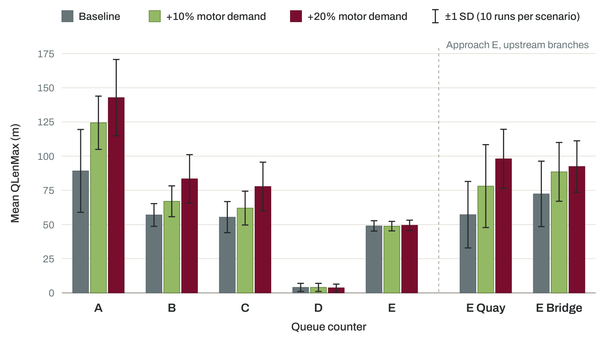

# Microscopic Traffic Simulation of a Signalised Intersection in Ghent, Belgium

**Independent transport modelling portfolio project · September–October 2026**

A microscopic traffic-simulation case study of the **R40–N430 / Neuseplein–Tolpoort intersection in Ghent, Belgium**, developed in **PTV Vissim 2026 SP10 Student Version**.

The project demonstrates a practical traffic-modelling workflow, including road-network reconstruction, coding of observed turning movements, fixed-time signal-control modelling, bicycle representation, stochastic scenario testing, and an exploratory tram-priority implementation.

**[Read the technical report (PDF)](report/Technical_Report.pdf)**

## Study at a glance

| Item | Description |
| --- | --- |
| Study location | R40 × N430 / Neuseplein–Tolpoort, Ghent, Belgium |
| Reference counts | AWV turning-movement observations, 9 February 2023, 16:00–17:00 |
| Observed demand | 3,059 motor vehicles/hour; 349 bicycles/hour represented in the model |
| Baseline signals | K1, 105-second fixed-time programme derived from AWV V-plan V010049 v17 (`Tr = 0`) |
| Simulation | Ten stochastic runs per scenario, 600 seconds per run |
| Main output | Queue length (`QLen`) and maximum queue length (`QLenMax`) |

## Scenarios

| Scenario | Motor demand | Tram operations | Archived Vissim model |
| --- | --- | --- | --- |
| Baseline | Observed demand | No | [INPX](models/Ghent_K1_Baseline.inpx) |
| +10% motor demand | +10% | No | [INPX](models/Ghent_K1_Demand_Plus10.inpx) |
| +20% motor demand | +20% | No | Original separate INPX not archived; results available |
| +10% demand with tram | +10% | Yes, exploratory detector-actuated control | [INPX](models/Ghent_K1_Demand_Plus10_Tram.inpx) |

Bicycle demand was held constant for motor-demand stress testing. The two upstream entry points of AWV approach E were modelled with an **assumed** 60% bridge / 40% quay demand split; this is not an observed origin split.

## Selected results

For approach A, mean maximum queue length (`QLenMax`, averaged over ten runs) was:

| Scenario | Mean QLenMax ± sample SD |
| --- | ---: |
| Baseline | 89.2 ± 30.3 m |
| +10% demand | 124.4 ± 19.5 m |
| +20% demand | 142.8 ± 27.9 m |
| +10% demand with trams | 129.6 ± 47.1 m |

These are outputs of exploratory model configurations, **not** verified real-world capacity estimates. Comparisons are limited by the short evaluation period, absence of a separate warm-up, differences between archived scenario network configurations, and the limited upstream extent of the model. The tram-priority strategy is **not** a reproduction of the actual AWV tram-control algorithm.


### Queue performance across demand scenarios



*Mean maximum queue length (QLenMax) by queue counter. Error bars indicate ±1 sample standard deviation across ten runs per scenario. E Quay and E Bridge are additional queue counters on the upstream branches of approach E.*

## Repository contents

```text
report/
  Technical_Report.pdf               # Full illustrated 16-page technical case study
models/
  Ghent_K1_Baseline.inpx
  Ghent_K1_Demand_Plus10.inpx
  Ghent_K1_Demand_Plus10_Tram.inpx
results/
  Baseline_10runs.xlsx
  Demand_Plus10_10runs.xlsx
  Demand_Plus20_10runs.xlsx
  Demand_Plus10_Tram_10runs.xlsx
assets/
  figure-08-demand-stress-testing.png  # Preview image embedded in this README
README.md
SOURCE_AND_USE_NOTES.md
```

## How to review

1. Start with the [illustrated report](report/Technical_Report.pdf), particularly the model construction, baseline assessment, stress tests, and tram-control sections.
2. View the available model files in **PTV Vissim 2026 SP10** (compatible license and local configuration required).
3. See the Excel results for the archived runs. The reported tables summarise ten runs per scenario.

The model files may refer to external background imagery or local project assets that are not redistributed here; complete on-screen replication of the original basemap is therefore not guaranteed. The +20% `.inpx` was not archived, and its reported result workbook is supplied without claiming a complete reproduction package for that scenario.

## Scope and limitations

- **Portfolio demonstration**, not a calibrated engineering consultancy model or an operational recommendation.
- AWV observed queue ranges serve as an approximate *baseline plausibility check*, not formal statistical validation.
- Simulation runs start with an empty network and last only 600 seconds due to Student Version limits.
- Pedestrians are outside the chosen simulation scope.
- Source observed traffic counts and the official AWV V-plan are not redistributed in this repository. Their provenance is identified in the report.
- All external imagery, software, and data remain subject to their original owners' rights and terms.

See [source and use notes](SOURCE_AND_USE_NOTES.md) for sharing and attribution caveats.
